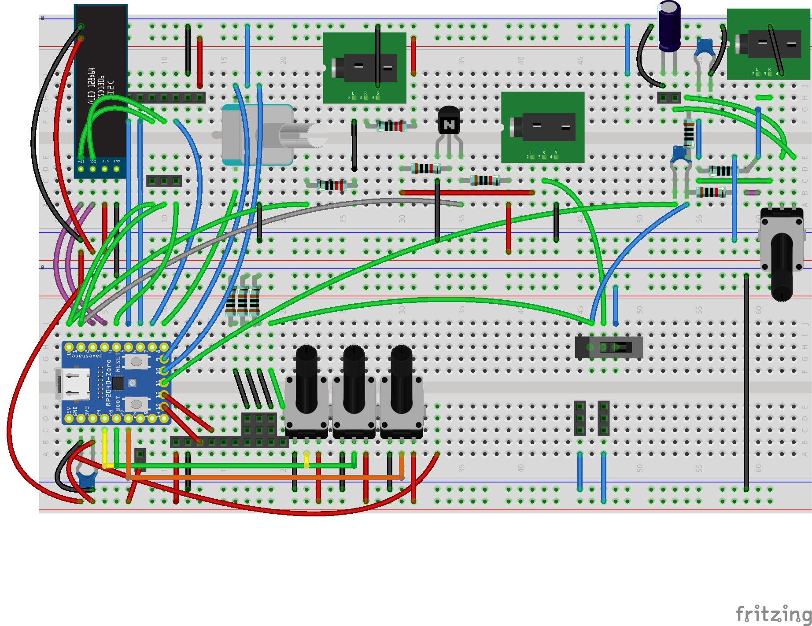
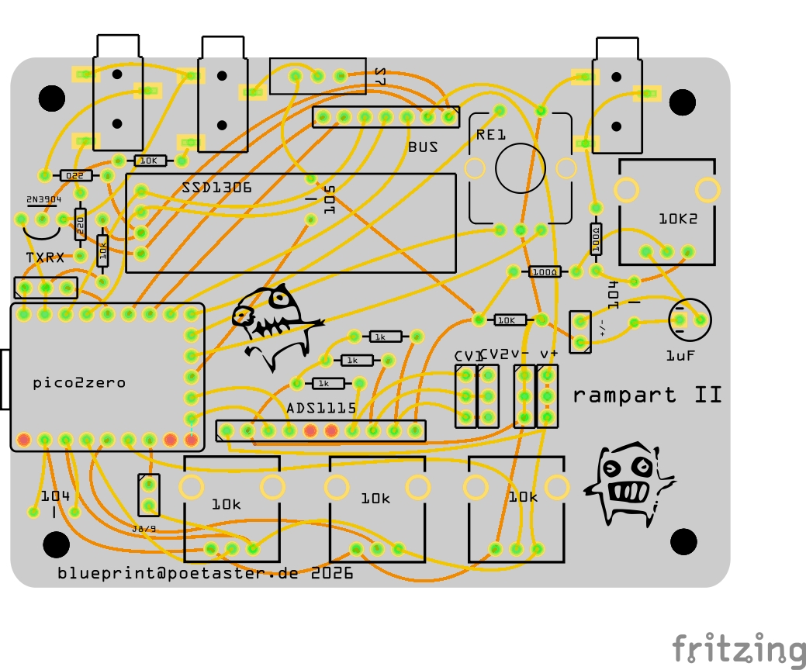
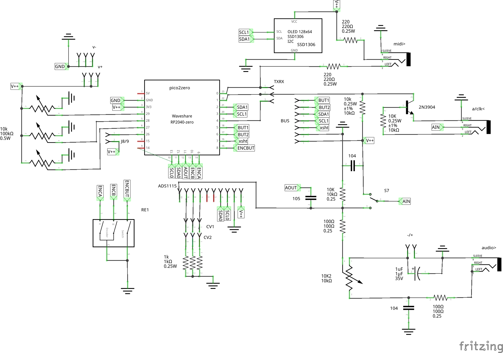

# rampartII
the continuation of my arduino semi-modular platform using the pi pico zero

I build the original rampart as a means for exploring doing audio with arduinos and interacting with devices like the Bastl Kastle. This generation is no different (new generation Kastles, too :). But, we have more inexpensive and powerful embedded processors now :) I chose the pi pico.

## hardware

## designs

Yes, it's done with fritzing. Because it's the only warez that will allow you to do Breadboard, Schematic and PCB views, etc. I breadboard designs first, so I use fritzing.

